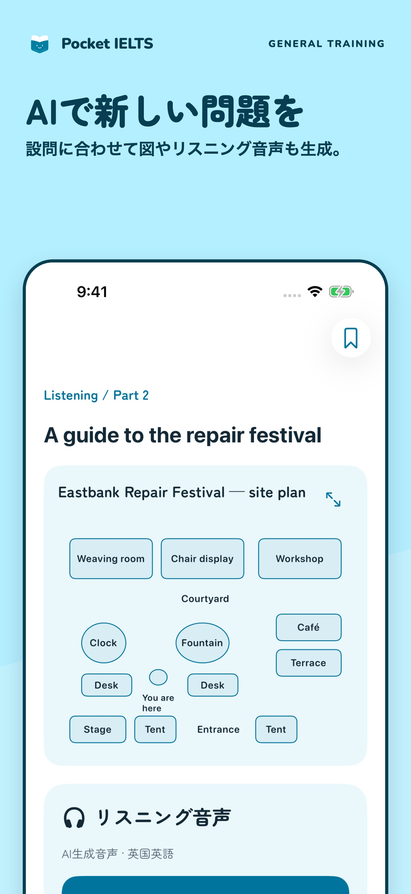
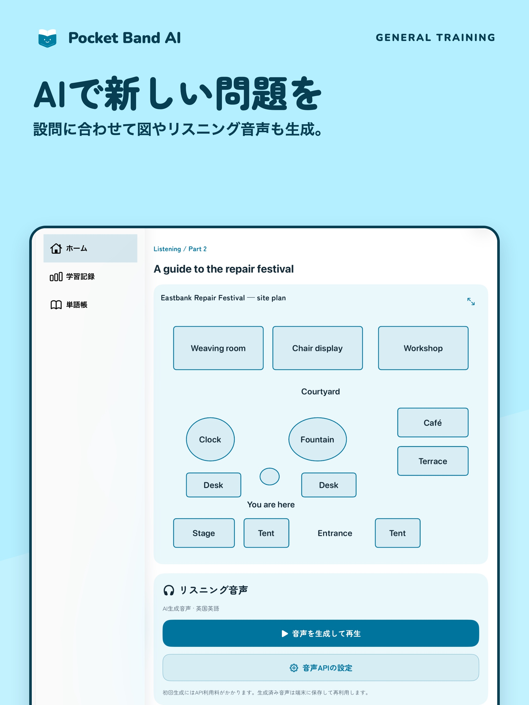
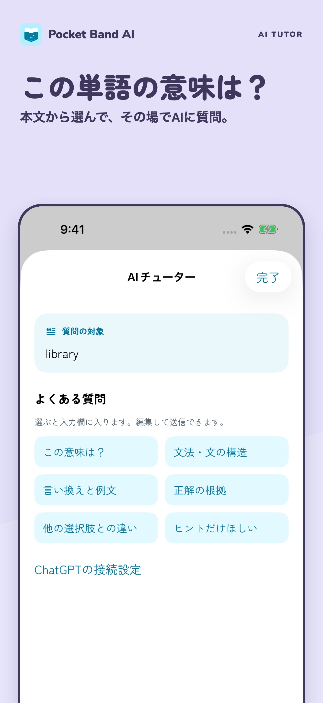
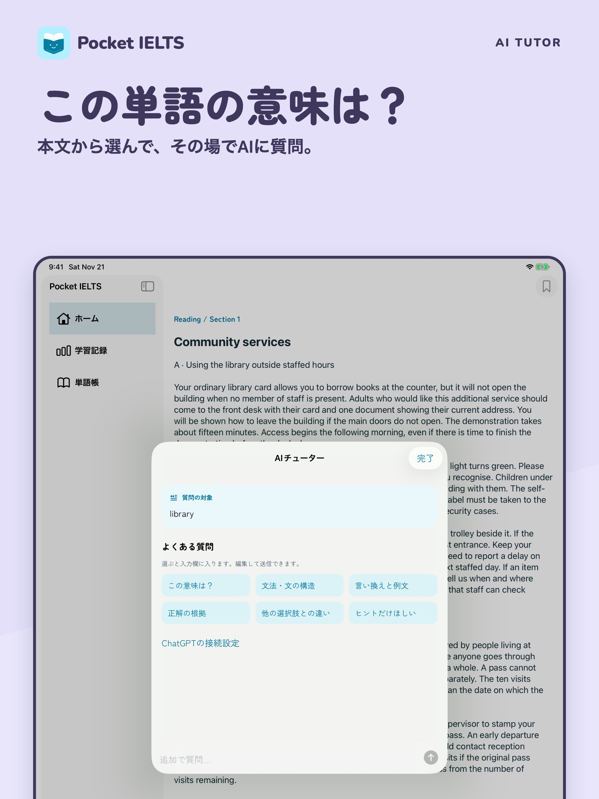
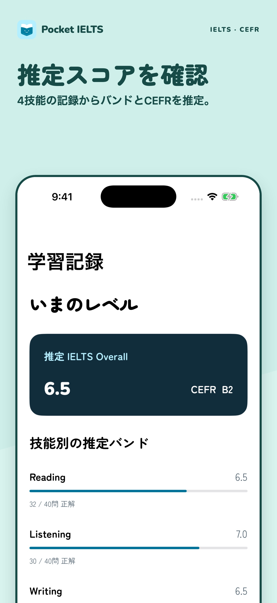
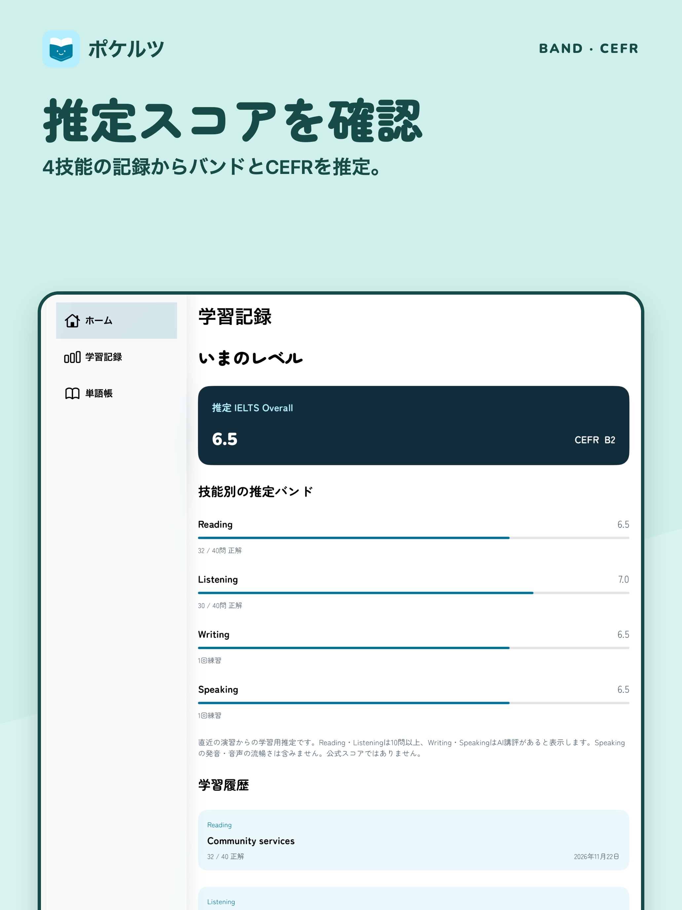
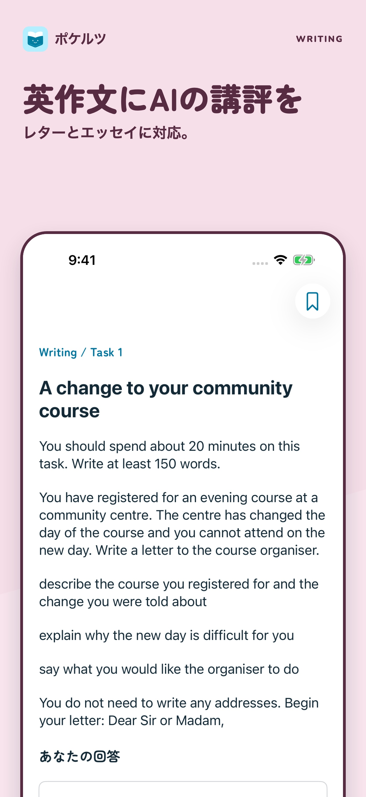
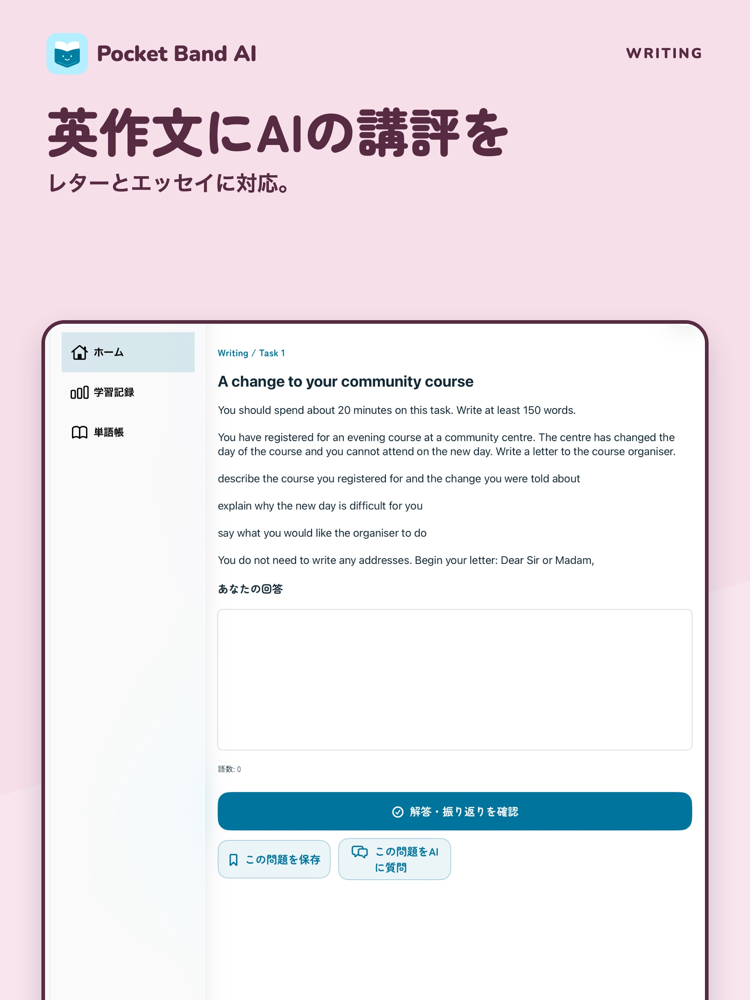
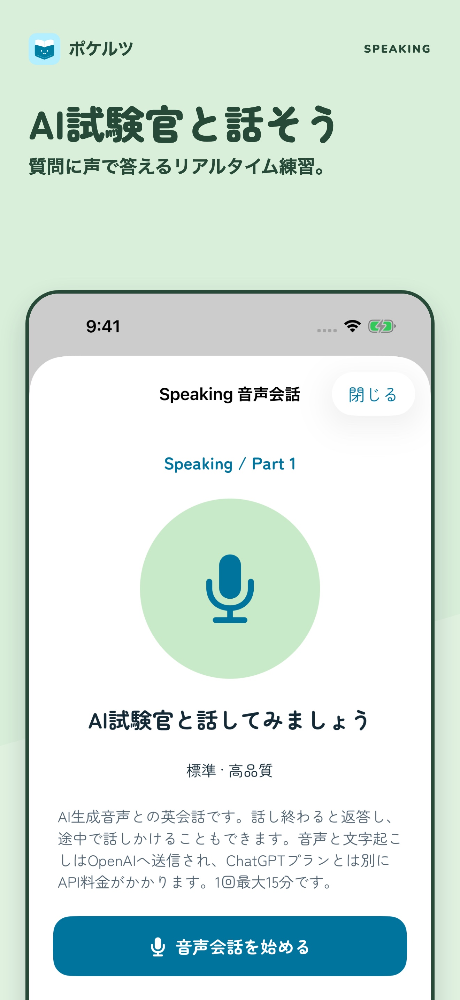
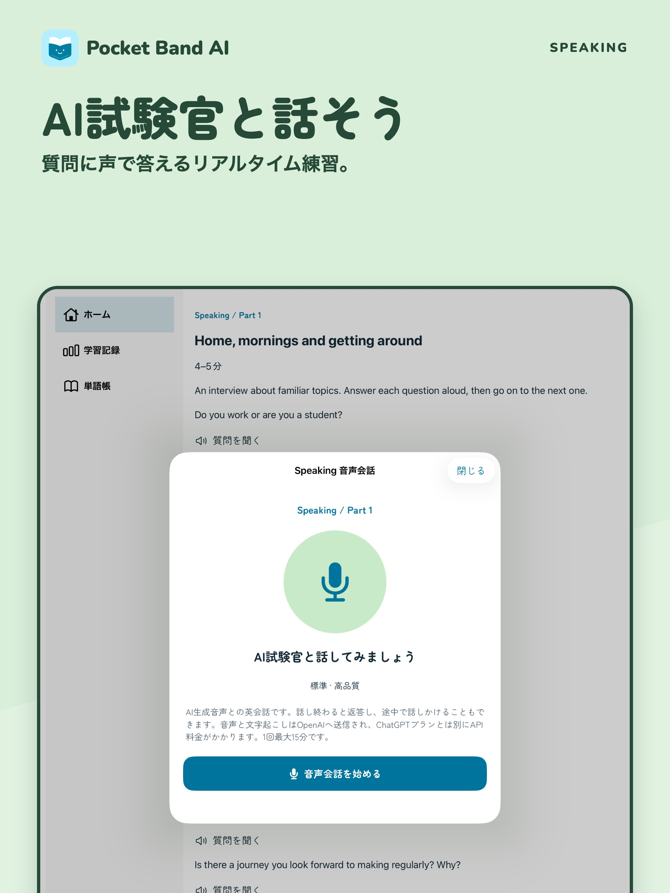

# App Store掲載画像（日本語）

番号が掲載順です。プレビューを選ぶと元サイズのJPEGを開けます。

| 掲載順 | iPhone（1320 × 2868） | iPad（2064 × 2752） |
|---|---|---|
| 1. AI問題生成 |  |  |
| 2. AIチューター |  |  |
| 3. 推定バンドとCEFR |  |  |
| 4. Writing |  |  |
| 5. Speaking |  |  |
