# Pocket IELTS


**Practice a skill. Save an expression. Pick up where you left off.**

Pocket IELTS is a native SwiftUI app for IELTS **General Training** practice on iPhone and iPad. It brings Reading, Listening, Writing and Speaking into one study space, with contextual vocabulary, saved exercises and a persistent learning history. Swipe a saved word or exercise to reveal Delete, then confirm. Finishing a practice offers to save unsaved exercises for later review. The interface supports **English, Japanese, Simplified and Traditional Chinese, Korean, Spanish, Brazilian Portuguese, Vietnamese, Indonesian, Thai, Hindi and Arabic**, following your iOS app language. Practice materials remain in English.

<p align="center">
  
  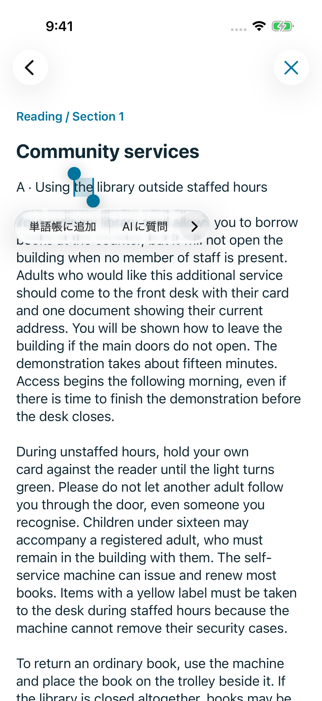
  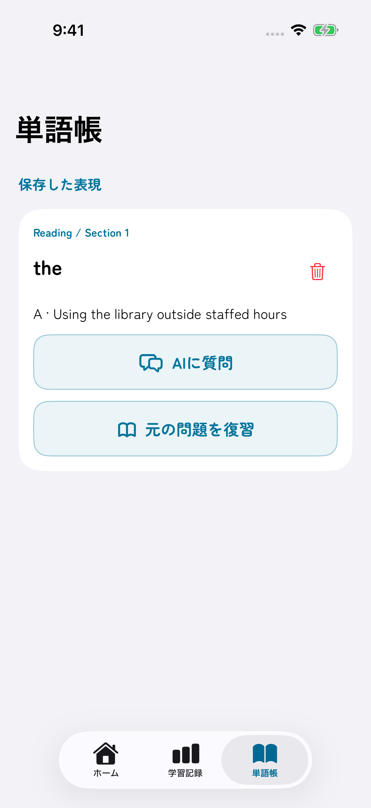
</p>

## A complete study loop

- **Four skills:** three Reading sections, four Listening parts, two Writing tasks and three Speaking parts. Start with bundled full-length exercises or generate fresh material with ChatGPT.
- **Vocabulary in context:** tap a word, or long-press to select a phrase, in passages, questions and explanations. Use the native selection menu to save immediately or ask the AI tutor, without an extra action sheet. Tap elsewhere to clear the selection. Edit meanings later in Vocabulary; the source sentence and original exercise stay attached.
- **Reading and Listening:** answer questions, review explanations and retry. Listening can generate natural British-English audio through the OpenAI Speech API, cache it locally, and play, pause, stop or seek. Playback and pending generation stop when leaving the screen.
- **Writing:** compose a response with a word count, then request criterion-based feedback and an improved example.
- **Speaking:** talk with an AI examiner using the Realtime API, with automatic turn detection, interruption, microphone mute, and a reviewable transcript. Mini (`gpt-realtime-2.1-mini`) is the default; Settings can select Standard (`gpt-realtime-2.1`) for the next session. Voice sessions use your personal audio API key and have separate API and transcription charges. Sessions stop on dismissal, backgrounding, interruption, or after 15 minutes. You can also record and replay an answer, transcribe it on-device where supported, and edit the transcript before requesting feedback. Manual transcription remains available.
- **Mock practice:** work through all 12 parts, with an elapsed-time display and feedback deferred until the end.
- **Learning history:** revisit answers, feedback, recordings and source exercises. Track formative IELTS-band and CEFR estimates as evidence accumulates.

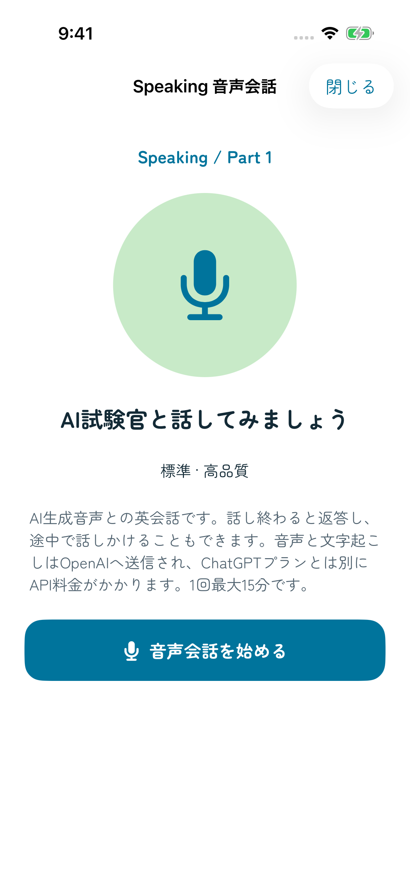

Speaking feedback evaluates the transcript, not pronunciation or acoustic fluency. Estimates are learning guidance, not official IELTS test results.

## A little company while you wait


Fresh questions are prepared with a gently floating book, an estimated percentage and a count of completed, validated sections. The percentage is **a time-based estimate, not progress reported by the AI service**; each unfinished section stays below completion until its response is validated. The illustration animates separately from progress text at up to 60 updates per second. Reduce Motion keeps it still; inactive scenes pause it. Generation can be cancelled, and failed multi-part generation resumes from the sections already completed.

In each part card, **Practice bundled questions** opens the included exercise. **Generate new questions** requests fresh material through ChatGPT.

## Clear questions and useful next steps

Instructions are separated from individual questions. Lettered choices appear on separate rows, with a clear selected state and no duplicated question numbers. After review, a prominent result button sits above outlined, icon-labeled actions for saving, asking AI and retrying. Review and completion open at the top without a button morphing animation. Ending practice uses a centered confirmation alert with **Save and finish**, **Finish without saving** and **Continue**. Already-saved exercises skip the save question. Mock tests list the unsaved parts being saved. Cancelling keeps the current answers.

New Reading and Listening attempts preserve every answer, including unanswered positions. History shows a score card and an expandable question-by-question review. Older records keep their existing saved data; missing historical answers cannot be reconstructed.

The tutor offers six editable question starters: meaning, grammar, paraphrases and examples, answer evidence, alternative choices and a hint. Selecting one fills the draft; you decide when to send it.

<p align="center">
  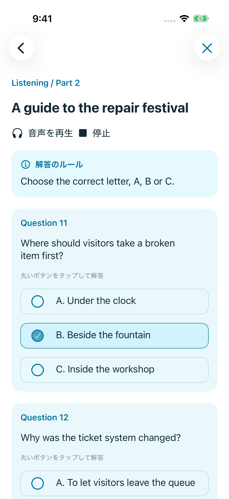
  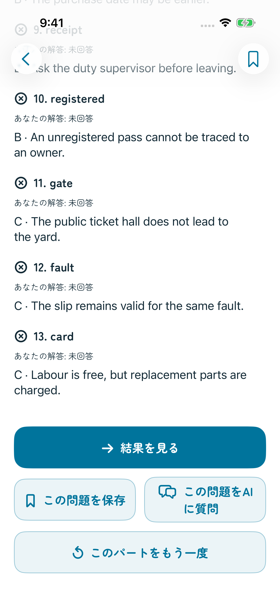
  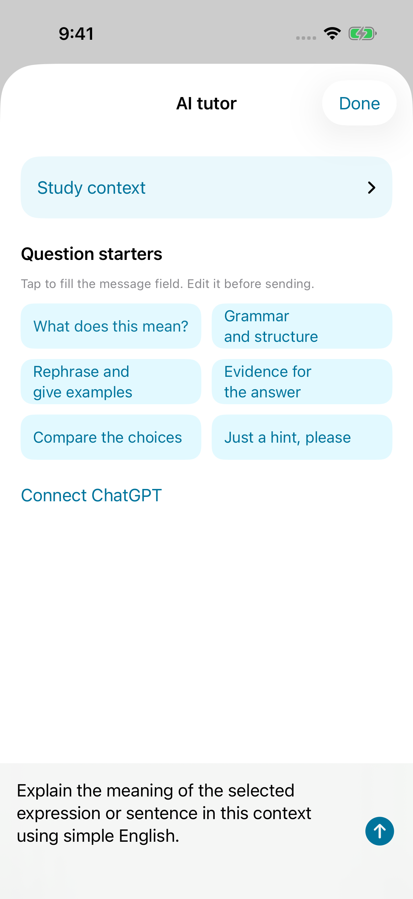
</p>

<p align="center">
  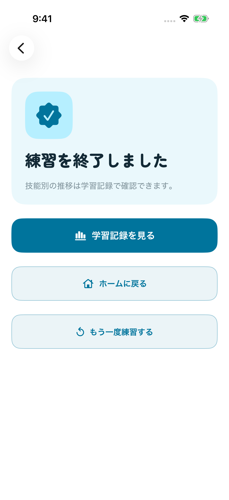
  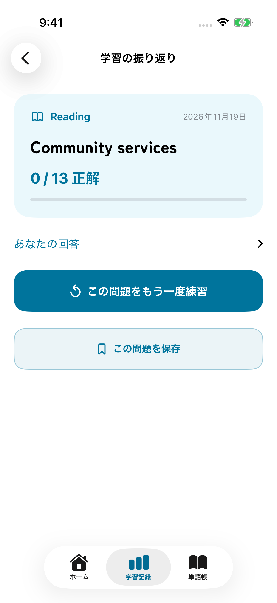
  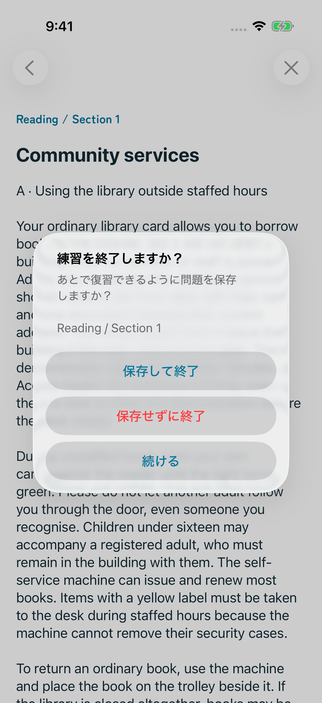
</p>

Swipe a vocabulary entry or saved exercise to reveal **Delete**, then confirm. Cancelling keeps it; confirmed deletions sync through iCloud without deleting your learning history.

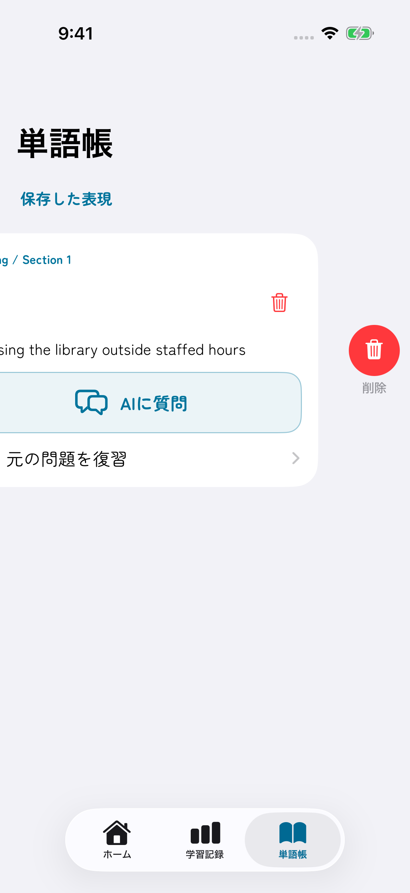

## Your language and appearance

Choose **System, Light or Dark** in Settings. The open settings sheet updates immediately, and the preference is saved on the device. App language follows the iOS language setting for Pocket IELTS. New AI explanations and feedback request the interface language; previously saved text is preserved in its original language.

<p align="center">
  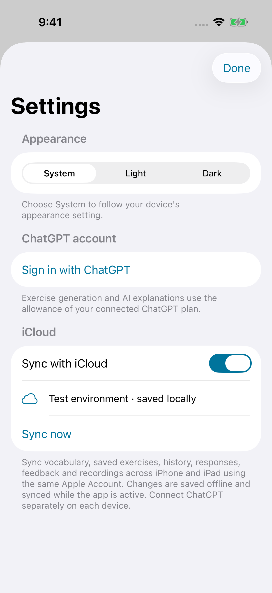
  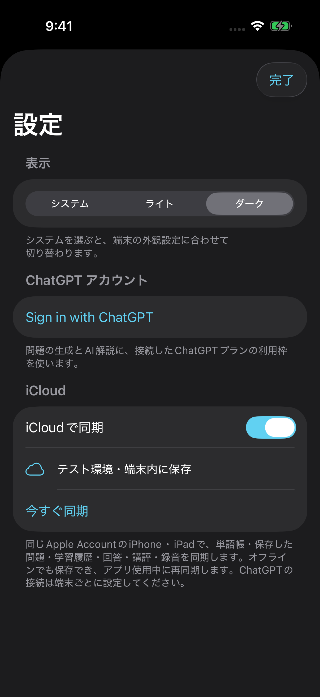
</p>

Translations are maintained in `Resources/Localizable.xcstrings` and `Resources/InfoPlist.xcstrings`, including permission descriptions. `python3 Scripts/check-localizations.py` checks all 12 languages and format placeholders; GitHub Actions runs this check on every build.

## Made for iPad, too


On iPad, a native sidebar keeps Home, Learning History and Vocabulary within reach. The dashboard places skill cards beside the progress and mock-test cards when space permits. Narrower windows stack the content; exercises and saved entries keep a comfortable maximum reading width. Portrait and landscape layouts share the same study data.

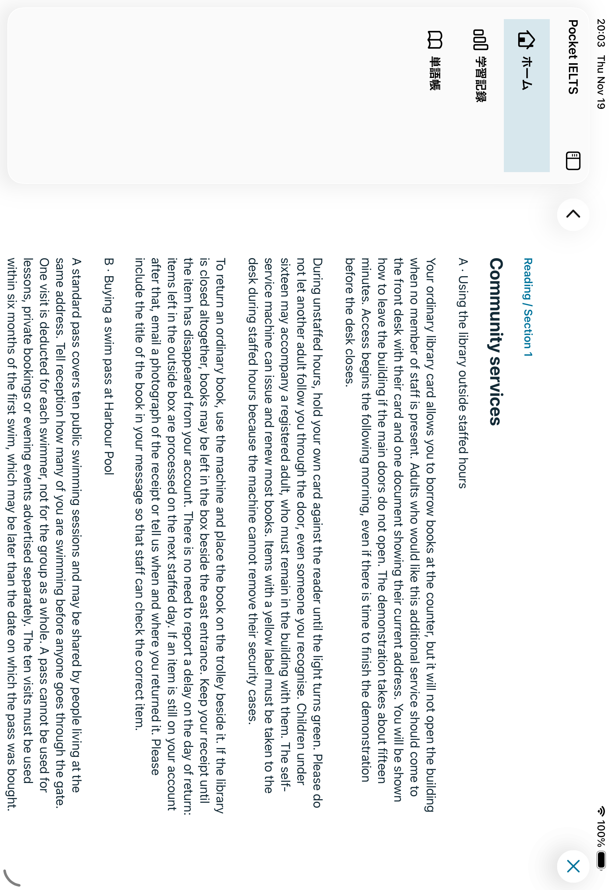

## Continue across devices with iCloud

The app includes CloudKit synchronization using your **private iCloud database**. With the same Apple Account on both devices, it synchronizes:

| Data | Included |
| --- | --- |
| Vocabulary | Expressions, meanings, context and source references |
| Saved exercises | Complete materials and questions |
| Completed practice | Answers, scores, feedback and history |
| Speaking recordings | Archived audio and saved transcripts |

Data is saved locally first. While the app is active, it checks for changes every 30 seconds; **Settings → iCloud → Sync now** starts a check immediately. Offline changes remain local until a successful sync. Independent additions are merged. If the same item is edited on two devices, the newer timestamp wins, with a stable revision tie-breaker.

Turning sync off keeps local data. Changing Apple Accounts pauses sync to avoid uploading the previous account's local data to another account. Return to the original account to resume. Live, unfinished practice sessions and ChatGPT credentials are not synchronized; sign in to ChatGPT separately on each device.

**Developer setup is required:** the CloudKit container and provisioning must be enabled for the signing team, and the schema must be deployed before TestFlight/App Store distribution. See [iCloud setup and verification](Documentation/iCloud.md). Simulator tests validate local merging and UI behavior; they do not prove a live two-device CloudKit round trip.

## ChatGPT connection

Connect through **Sign in with ChatGPT** in Settings. Text generation continues to use ChatGPT sign-in. Optional listening audio has a separate personal API-key field, a key-creation link and an API-usage link. Keys are stored in device-only Keychain; audio API usage is billed separately. Fresh exercise generation, word explanations, tutor conversations and assessments require a working ChatGPT connection and available usage. Bundled exercises and local study features work without an AI connection.

Authentication is stored in the device Keychain. When you explicitly request AI help, relevant exercise text and your question or written/transcribed response are sent to OpenAI. The recording workflow requests on-device recognition; recorded audio is not sent to the text-feedback endpoint. Realtime Speaking sends microphone audio to OpenAI for conversation and input transcription (`gpt-transcribe`); only the candidate’s transcript is passed to the existing feedback workflow. The app does not archive Realtime audio. Live microphone/speaker behavior and paid API connectivity require a device test with your own configured key; automated tests do not make paid requests. With iCloud sync enabled, archived recordings are uploaded to your private CloudKit database.

## Build and run

- **Xcode 27.2** was used for development and verification.
- Deployment target: **iOS / iPadOS 17.0+**.
- Swift Package Manager resolves **The Composable Architecture 1.26.0** and its dependencies.

1. Clone the repository and open `PocketIELTS.xcodeproj`.
2. Select the `PocketIELTS` scheme.
3. Choose your signing team. For iCloud, configure the container and entitlements described in [the setup guide](Documentation/iCloud.md).
4. Select an iPhone or iPad simulator/device, then run.
5. Connect ChatGPT in Settings if you want AI features.

```sh
xcodebuild -project PocketIELTS.xcodeproj \
  -scheme PocketIELTS \
  -destination 'platform=iOS Simulator,name=iPhone 17 Pro' \
  test
```

Use a simulator available in your Xcode installation. Microphone recording, speech-recognition permissions, live ChatGPT authentication and cross-device iCloud synchronization also need device/account verification.

## Project map

| Path | Purpose |
| --- | --- |
| `Sources/App` | App entry point, TCA state and adaptive navigation |
| `Sources/Features` | Home, practice, exam and settings screens |
| `Sources/DesignSystem` | Shared typography, colors, spacing and text selection |
| `Sources/Dependencies/Cloud` | CloudKit synchronization and record merge journal |
| `Sources/Dependencies/ChatGPT` | Account connection and inference transport |
| `Resources/GeneralTraining.json` | Bundled practice material |
| `Tests` / `UITests` | Persistence, scoring, sync-conflict and UI-flow tests |

The [Figma file](https://www.figma.com/design/bYd2T51eVSh9tDzzehJtMa/IETLS_Study) is the design reference, including the iPad layouts and iCloud settings. See [the implementation audit](Documentation/implementation-audit.json) for implementation details and verification limits.

Screenshots show the running app in the iOS 26.5 simulator using isolated test storage. They contain no personal account data and do not depict a verified cloud sync. UI-test screenshot capture is in `testZScreenshotsAndAdaptiveNavigation`. The loading screenshot uses the DEBUG-only `--ui-generation-preview` fixture; it does not represent a live AI request.

## Credits

The display typography uses **Nunito** and **Zen Maru Gothic**. Their Open Font License files are included in `Resources/Fonts`. Japanese UI labels use Zen Maru Gothic Regular/Bold; Latin-script UI labels use Nunito; other scripts use native fonts for correct shaping. Arabic interfaces follow right-to-left layout. AI explanations follow the app language; existing saved explanations keep their original language. Long exercise passages retain native Dynamic Type. Icons use SF Symbols. Settings includes an offline OSS acknowledgements browser generated by LicensePlist, covering all resolved packages and both fonts.

The original [pocket-book app icon](Documentation/Brand/README.md) includes light, dark and tinted appearances, with editable SVGs and a reproducible asset generator.


## Saved learning and vocabulary

Open **Practise saved questions** from Home or a skill’s part picker. Saved questions live with practice entry points, while Vocabulary contains saved words and expressions. Each expression can open the AI tutor with its original context and word-focused suggested questions. Delete uses a confirmation alert; deletion records sync through iCloud so an older offline copy does not restore the word.

## Continuous integration and dependencies

GitHub Actions runs unit and UI tests on iPhone and iPad simulators for pushes and pull requests. Local development uses Xcode 27.2; the hosted workflow selects Xcode 26.6, currently present on the `macos-26` image. Result bundles and generated OSS notices are uploaded as artifacts. Tests use fixtures and do not make paid audio API requests.

Dependabot checks Swift Package Manager dependencies (including the Xcode project’s `Package.resolved`) and GitHub Actions weekly. It starts once `.github/dependabot.yml` is on the default branch. Compatible Swift updates are grouped; major updates remain separate.

Every Xcode **Build / Run / Archive** runs the target's **Sync OSS Licenses** phase after Copy Bundle Resources and before code signing. It generates notices from the current resolved package checkouts, validates complete package/font coverage, then synchronizes the generated files directly into the app's `Licenses` folder. Removed dependencies are removed from the bundle too. A missing or invalid notice fails the build instead of shipping stale acknowledgements.

LicensePlist **3.28.3** is downloaded from its official release with a pinned SHA-256 checksum on first use, then reused from `~/Library/Caches/PocketIELTS/LicensePlist`. First setup requires internet access; subsequent generation uses local package sources without network license lookups. CI runs this same build phase. Generated plist files are build artifacts, not a second committed source of truth.

For manual inspection after resolving Swift packages:

```sh
Scripts/generate-licenses.sh /path/to/DerivedData/SourcePackages /tmp/pocket-licenses
```

If using `xcodebuild -clonedSourcePackagesDirPath`, also pass `LICENSE_PLIST_PACKAGE_SOURCES_PATH=/absolute/path/to/SourcePackages`. `LICENSE_PLIST_BIN` can point to an already installed executable for offline/managed environments. To bootstrap the pinned tool in advance, run `Scripts/licenseplist-tool.sh`.

### Saved practice and audio playback

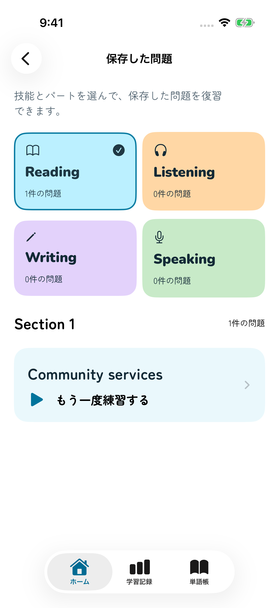

Saved questions are available from Home and the skill selection screens, grouped by Reading, Listening, Writing and Speaking, then by Section, Part or Task. Each skill shows its saved count. Swipe a saved question to reveal Delete, then confirm to remove it. Learning history and saved vocabulary are retained; deletion records sync through iCloud, and you can explicitly save the question again later.

Listening audio uses separate, consistent voices for dialogue speakers. Speaker labels are excluded from spoken input. Generation progress shows the percentage of completed audio segments and reaches 100% before playback. Completed segments are cached on the device. Audio generation requires your own OpenAI API key and incurs API charges; ChatGPT sign-in remains separate.

AI tutor answers use Apple's Foundation Markdown parser with native selectable text for headings, emphasis and lists. Selected words can still be saved.


## Offline learning and your own vocabulary

Open **Offline practice** on Home to choose from the 12 bundled General Training parts: 3 Reading sections, 4 Listening parts, 2 Writing tasks and 3 Speaking parts. The included Reading passages, 40 questions, marking and explanations need no sign-in or internet. Writing prompts and Speaking topics are also bundled. AI feedback, live conversations and generating new Listening audio require internet; audio is not preinstalled with the app.

Vocabulary has two separate areas: **My vocabulary** for your saved expressions, and **General Training word library** with **1,000 original words and phrases**, each with an English meaning and a contextual example. Ten topics cover housing, work, study and training, shopping and services, travel, health, community, money, letters and requests, and society and environment. The collection works offline and does not populate or change your personal saved words.

Tap **+** in Vocabulary to add a word or phrase and an optional example sentence. You can ask the AI tutor about the entered expression before saving, or from its saved card afterward. Blank entries and duplicate manually added words are prevented. Personal entries use the existing iCloud synchronization and swipe-to-delete flow.

<p align="center">
  
  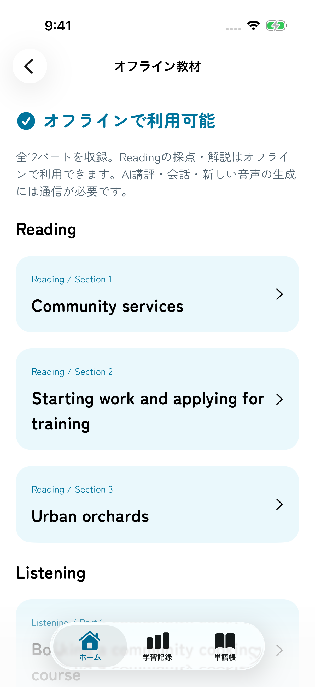
  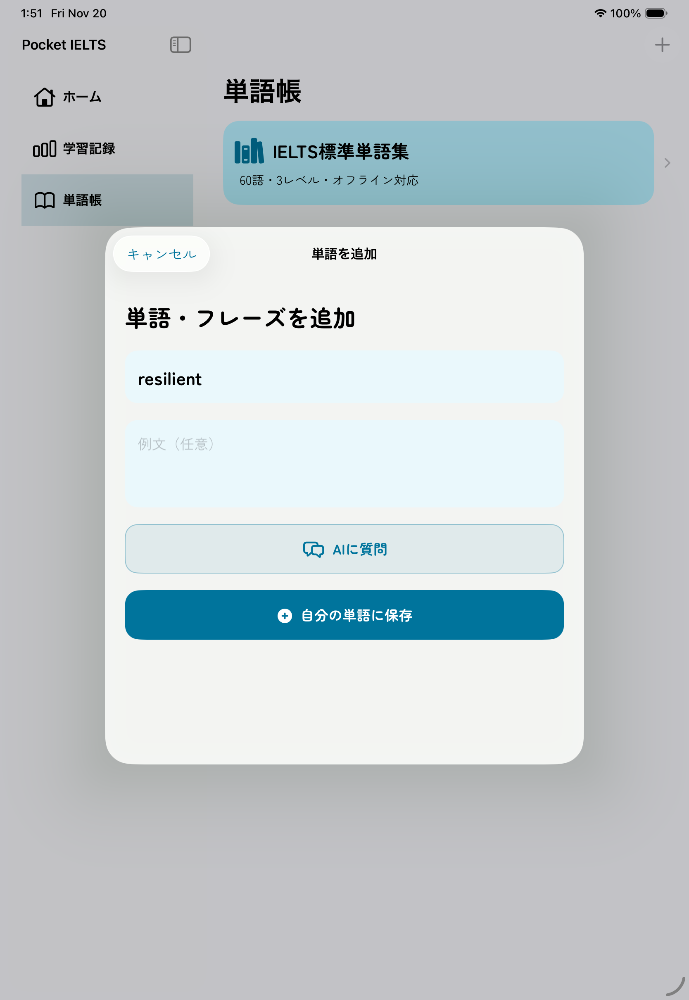
</p>

## Signing in on Mac

For **My Mac (Designed for iPad)**, ChatGPT sign-in now uses `ASWebAuthenticationSession` while the app keeps its loopback listener alive. The previous Safari view-controller path is retained on iPhone and iPad. [Apple documents the external-browser behavior of Safari view controllers on Mac Catalyst](https://developer.apple.com/documentation/safariservices/sfsafariviewcontroller).

After updating, start a new sign-in from Settings; an old localhost error tab belongs to an expired attempt and cannot complete a new sign-in. The callback is checked against the original OAuth state, and the listener is cleaned up after completion or cancellation. A local integration test verifies the callback without an OpenAI request. Live account authentication still requires verification on the Mac with the user's account.

### General Training vocabulary

The collection contains 100 entries in each of ten topics: 400 Foundation (Band 4–5 guide), 400 Developing (5.5–6.5 guide) and 200 Advanced (7+ guide) entries overall. The score-based groups are retained; the library uses level selection and search without a topic filter. These are editorial learning guides, not official IELTS band assignments, CEFR classifications or an official word list. Content was rewritten for everyday life, employment, services and correspondence, following the contexts described in the official [General Training Reading format](https://ielts.org/take-a-test/test-types/ielts-general-training-test/ielts-general-training-format-reading/) and [Writing format](https://ielts.org/take-a-test/test-types/ielts-general-training-test/ielts-general-training-format-writing). Every definition and example in this collection is original; the previous WordNet subset is no longer bundled.

Choose a score-based level, then search words or definitions. Flashcard entry points have been removed from both vocabulary screens to keep the flow simple. Saved words and the General Training library remain separate.

The small speaker button beside each word (**Hear pronunciation** for VoiceOver) uses an installed English system voice, preferring British English. It does not call a paid API. Playback stops when changing cards, leaving the screen or moving the app to the background. Offline playback depends on an English voice being installed on the device.

During exercise generation, a card immediately displays a **word, meaning and example**. Your saved words appear first in random order, followed by shuffled General Training words. Expressions are deduplicated across both collections, so even one saved word advances to a different word. Saved expressions without a definition are included with a clear “No saved meaning” label. The card fits its word, meaning and example without reserving empty space. **Next word** sits above the changing content to keep the control stable; longer text scrolls with the page. **Next word** and pronunciation are optional; there is no quiz or additional API request. The exercise still opens after the loading indicator reaches 100%.

The editable source is in [Scripts/Vocabulary](Scripts/Vocabulary); rebuild and validate all 1,000 entries with `python3 Scripts/build-vocabulary.py`. CI checks that this reproduces the bundled JSON.

<p align="center">
  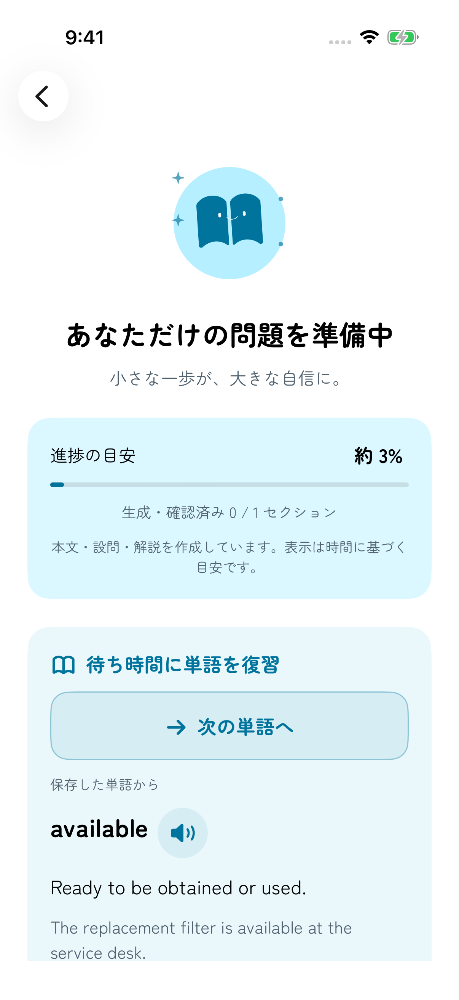
  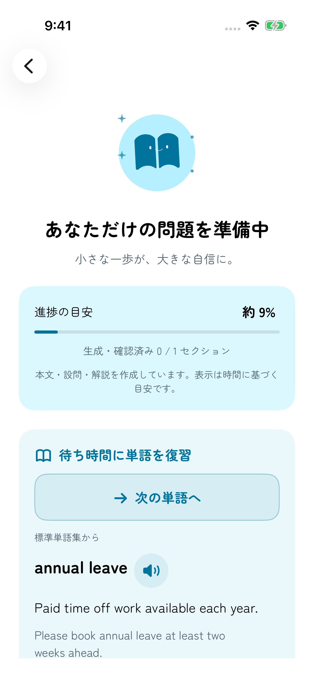
</p>

### Leaving a practice session

The upper-left back button opens the exit confirmation; the upper-right bookmark saves the current paper. **Save and finish** remains available even if the paper is already saved (saving is idempotent). Finishing pushes the completion screen using native navigation. Returning Home pops the existing stack rather than rebuilding it; mock-test covers dismiss before the underlying navigation changes. Reduce Motion is respected.
