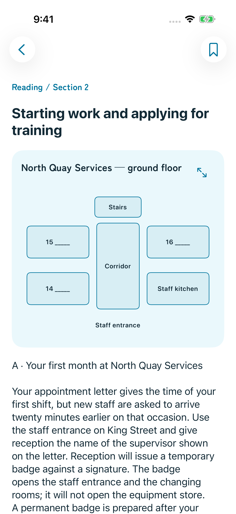
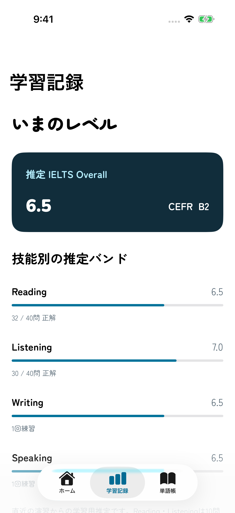

# Pocket IELTS

iPhone・iPadでIELTS General Trainingの4技能を練習できるアプリです。苦手なパートを選んで解き、解説で迷った箇所を振り返れます。

  
  
  

- **問題生成**　AIがパートごとに新しい問題を作成。設問に応じた図やListening音声も生成できます。
- **AIチューター**　本文で知らない単語を選び、その文での意味や使い方を質問できます。
- **Writing・Speaking**　レターやエッセイの講評を受けたり、AI試験官とリアルタイムで英会話を練習したりできます。
- **学習記録**　Reading・Listeningの正答状況とWriting・Speakingの評価がそろうと、総合バンドスコアとCEFRの目安を表示します。

問題生成とAI解説にはChatGPT接続を使います。任意の音声生成・画像生成・リアルタイム英会話には、個人のOpenAI APIキーと別途API利用料が必要です。

## 開発

対象はiOS・iPadOS 26以降です。Xcodeで `PocketIELTS.xcodeproj` を開き、`PocketIELTS` スキームで実行してください。

[ストア掲載用画像](Documentation/AppStore/ja) · [iCloudの設定](Documentation/iCloud.md) · [アイコン](Documentation/Brand/README.md) · [フォントとライセンス](Resources/Fonts)

本プロジェクトは [MIT License](LICENSE) で公開しています。同梱フォントと外部ライブラリには、それぞれのライセンスが適用されます。
