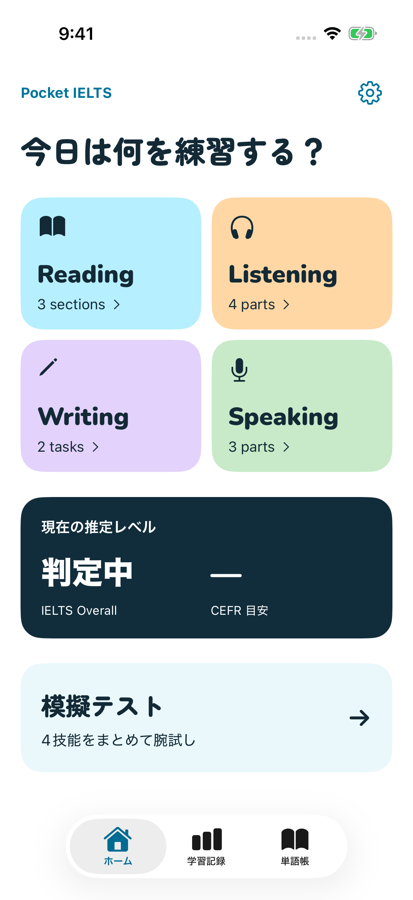
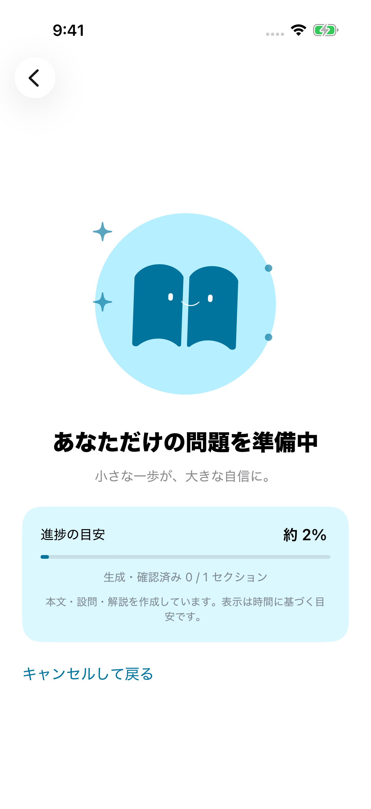
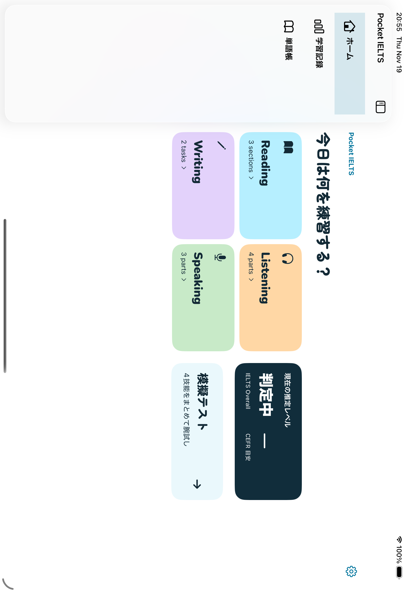

# Pocket IELTS


**Practice a skill. Save an expression. Pick up where you left off.**

Pocket IELTS is a native SwiftUI app for IELTS **General Training** practice on iPhone and iPad. It brings Reading, Listening, Writing and Speaking into one study space, with contextual vocabulary, saved exercises and a persistent learning history. The interface is currently in Japanese; practice materials are in English.

<p align="center">
  
  
  
</p>

## A complete study loop

- **Four skills:** three Reading sections, four Listening parts, two Writing tasks and three Speaking parts. Start with bundled full-length exercises or generate fresh material with ChatGPT.
- **Vocabulary in context:** tap a word, or long-press to select a phrase, in passages, questions and explanations. Use the native selection menu to save immediately or ask the AI tutor, without an extra action sheet. Tap elsewhere to clear the selection. Edit meanings later in Vocabulary; the source sentence and original exercise stay attached.
- **Reading and Listening:** answer questions, review explanations and retry. Listening uses system text-to-speech playback.
- **Writing:** compose a response with a word count, then request criterion-based feedback and an improved example.
- **Speaking:** record and replay an answer, transcribe it on-device where supported, and edit the transcript before requesting feedback. Manual transcription remains available.
- **Mock practice:** work through all 12 parts, with an elapsed-time display and feedback deferred until the end.
- **Learning history:** revisit answers, feedback, recordings and source exercises. Track formative IELTS-band and CEFR estimates as evidence accumulates.

Speaking feedback evaluates the transcript, not pronunciation or acoustic fluency. Estimates are learning guidance, not official IELTS test results.

## A little company while you wait



Fresh questions are prepared with a gently floating book, an estimated percentage and a count of completed, validated sections. The percentage is **a time-based estimate, not progress reported by the AI service**; each unfinished section stays below completion until its response is validated. The illustration animates separately from progress text at up to 60 updates per second. Reduce Motion keeps it still; inactive scenes pause it. Generation can be cancelled, and failed multi-part generation resumes from the sections already completed.

In each part card, **Practice bundled questions** opens the included exercise. **Generate new questions** requests fresh material through ChatGPT.

## Made for iPad, too



On iPad, a native sidebar keeps Home, Learning History and Vocabulary within reach. The dashboard places skill cards beside the progress and mock-test cards when space permits. Narrower windows stack the content; exercises and saved entries keep a comfortable maximum reading width. Portrait and landscape layouts share the same study data.


## Continue across devices with iCloud

The app includes CloudKit synchronization using your **private iCloud database**. With the same Apple Account on both devices, it synchronizes:

| Data | Included |
| --- | --- |
| Vocabulary | Expressions, meanings, context and source references |
| Saved exercises | Complete materials and questions |
| Completed practice | Answers, scores, feedback and history |
| Speaking recordings | Archived audio and saved transcripts |

Data is saved locally first. While the app is active, it checks for changes every 30 seconds; **Settings → iCloud → Sync now** starts a check immediately. Offline changes remain local until a successful sync. Independent additions are merged. If the same item is edited on two devices, the newer timestamp wins, with a stable revision tie-breaker.

Turning sync off keeps local data. Changing Apple Accounts pauses sync to avoid uploading the previous account's local data to another account. Return to the original account to resume. Live, unfinished practice sessions and ChatGPT credentials are not synchronized; sign in to ChatGPT separately on each device.

**Developer setup is required:** the CloudKit container and provisioning must be enabled for the signing team, and the schema must be deployed before TestFlight/App Store distribution. See [iCloud setup and verification](Documentation/iCloud.md). Simulator tests validate local merging and UI behavior; they do not prove a live two-device CloudKit round trip.

## ChatGPT connection

Connect through **Sign in with ChatGPT** in Settings. There is no API-key entry flow. Fresh exercise generation, word explanations, tutor conversations and assessments require a working ChatGPT connection and available usage. Bundled exercises and local study features work without an AI connection.

Authentication is stored in the device Keychain. When you explicitly request AI help, relevant exercise text and your question or written/transcribed response are sent to OpenAI. Speaking transcription requests on-device recognition; recorded audio is not sent to the text-feedback endpoint. With iCloud sync enabled, archived recordings are uploaded to your private CloudKit database.

## Build and run

- **Xcode 27.2** was used for development and verification.
- Deployment target: **iOS / iPadOS 17.0+**.
- Swift Package Manager resolves **The Composable Architecture 1.26.0** and its dependencies.

1. Clone the repository and open `PocketIELTS.xcodeproj`.
2. Select the `PocketIELTS` scheme.
3. Choose your signing team. For iCloud, configure the container and entitlements described in [the setup guide](Documentation/iCloud.md).
4. Select an iPhone or iPad simulator/device, then run.
5. Connect ChatGPT in Settings if you want AI features.

```sh
xcodebuild -project PocketIELTS.xcodeproj \
  -scheme PocketIELTS \
  -destination 'platform=iOS Simulator,name=iPhone 17 Pro' \
  test
```

Use a simulator available in your Xcode installation. Microphone recording, speech-recognition permissions, live ChatGPT authentication and cross-device iCloud synchronization also need device/account verification.

## Project map

| Path | Purpose |
| --- | --- |
| `Sources/App` | App entry point, TCA state and adaptive navigation |
| `Sources/Features` | Home, practice, exam and settings screens |
| `Sources/DesignSystem` | Shared typography, colors, spacing and text selection |
| `Sources/Dependencies/Cloud` | CloudKit synchronization and record merge journal |
| `Sources/Dependencies/ChatGPT` | Account connection and inference transport |
| `Resources/GeneralTraining.json` | Bundled practice material |
| `Tests` / `UITests` | Persistence, scoring, sync-conflict and UI-flow tests |

The [Figma file](https://www.figma.com/design/bYd2T51eVSh9tDzzehJtMa/IETLS_Study) is the design reference, including the iPad layouts and iCloud settings. See [the implementation audit](Documentation/implementation-audit.json) for implementation details and verification limits.

Screenshots show the running app in the iOS 26.5 simulator using isolated test storage. They contain no personal account data and do not depict a verified cloud sync. UI-test screenshot capture is in `testZScreenshotsAndAdaptiveNavigation`. The loading screenshot uses the DEBUG-only `--ui-generation-preview` fixture; it does not represent a live AI request.

## Credits

The display typography uses **Nunito** and **Zen Maru Gothic**. Their Open Font License files are included in `Resources/Fonts`. System controls and icons use SwiftUI, UIKit and SF Symbols.

The original [pocket-book app icon](Documentation/Brand/README.md) includes light, dark and tinted appearances, with editable SVGs and a reproducible asset generator.
