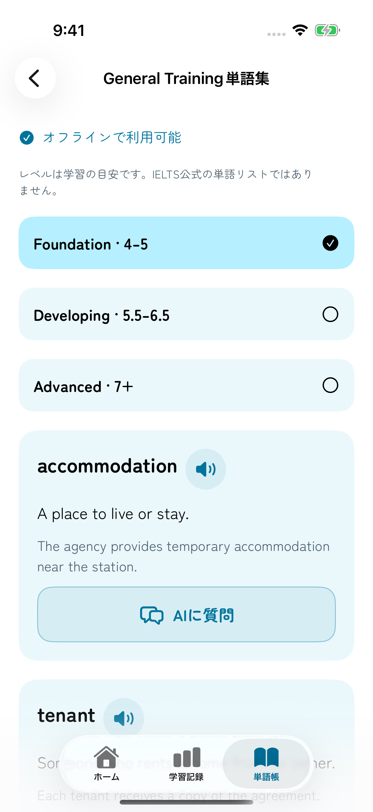

# Pocket IELTS

iPhone・iPadでIELTS General Trainingの4技能を練習できるアプリです。苦手なパートを選んで解き、解説で迷った箇所を振り返れます。

  
  
  

- **練習**　Listening・Reading・Writing・Speakingのパート別練習と、4技能の模擬テストに対応しています。
- **復習**　問題や表現を保存でき、解説で疑問が残ったら、その設問についてAIチューターに質問できます。
- **単語帳**　生活や仕事で使う1,000の英単語・表現を、レベル別に意味・例文と一緒に学べます。収録単語はオフラインでも利用できます。

問題生成とAI解説にはChatGPT接続を使います。任意の音声生成・画像生成・リアルタイム英会話には、個人のOpenAI APIキーと別途API利用料が必要です。

## 開発

対象はiOS・iPadOS 26以降です。Xcodeで `PocketIELTS.xcodeproj` を開き、`PocketIELTS` スキームで実行してください。

[ストア掲載用画像](Documentation/AppStore/ja) · [iCloudの設定](Documentation/iCloud.md) · [アイコン](Documentation/Brand/README.md) · [フォントとライセンス](Resources/Fonts)
